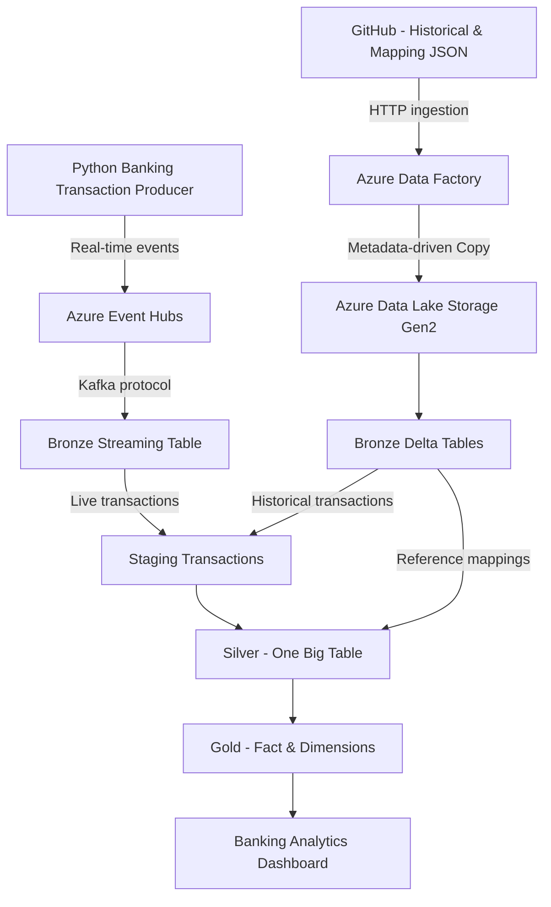
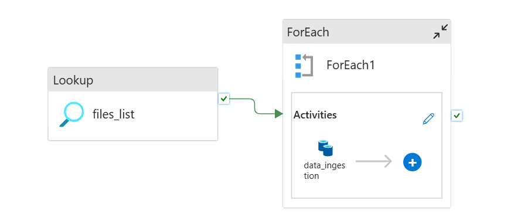
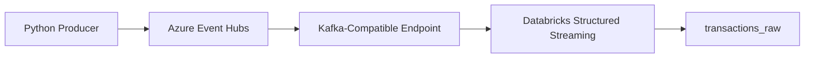
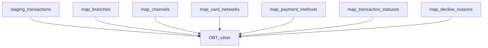
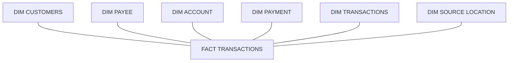
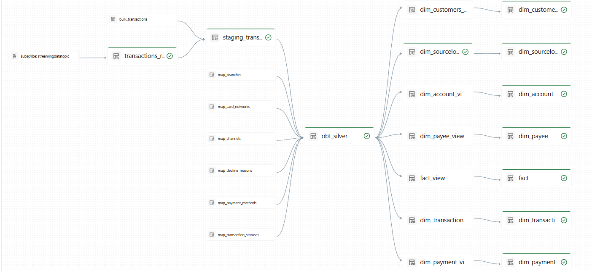
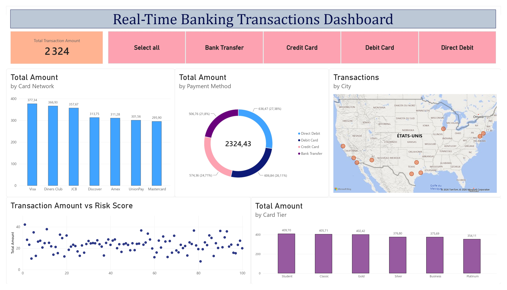

# Real-Time Banking Transactions | Azure Data Engineering Pipeline

### End-to-End Streaming Data Engineering with Azure Databricks, Event Hubs, Data Factory, PySpark & Delta Lake

An end-to-end **Azure Data Engineering project** that simulates a real-time banking transaction processing system using **synthetic financial data**.

The project integrates historical transaction records with live streaming events, implements a **Medallion Architecture (Bronze, Silver, Gold)**, performs streaming transformations and dimensional modeling, and delivers an interactive banking analytics dashboard.

It demonstrates how modern cloud data engineering technologies can be integrated to build a scalable, metadata-driven, event-based analytics architecture.

> **Project scope:** Educational and portfolio-scale implementation using synthetic banking transactions. No real customer or financial information is processed.

---

## Table of Contents

1. [Project Overview](#project-overview)
2. [Architecture](#architecture)
3. [Technologies Used](#technologies-used)
4. [Data Sources](#data-sources)
5. [Azure Data Factory - Metadata-Driven Ingestion](#azure-data-factory---metadata-driven-ingestion)
6. [Real-Time Streaming with Azure Event Hubs](#real-time-streaming-with-azure-event-hubs)
7. [Medallion Architecture](#medallion-architecture)
8. [Silver Layer - Data Enrichment](#silver-layer---data-enrichment)
9. [Gold Layer - Dimensional Modeling](#gold-layer---dimensional-modeling)
10. [Change Data Capture and SCD](#change-data-capture-and-scd)
11. [Dynamic SQL Generation with Jinja2](#dynamic-sql-generation-with-jinja2)
12. [Databricks Pipeline DAG](#databricks-pipeline-dag)
13. [Banking Analytics Dashboard](#banking-analytics-dashboard)
14. [Technical Challenges and Engineering Decisions](#technical-challenges-and-engineering-decisions)
15. [Project Setup](#project-setup)
16. [Security Considerations](#security-considerations)
17. [Future Improvements](#future-improvements)
18. [Skills Demonstrated](#skills-demonstrated)

---

## Project Overview

Modern banking systems generate large volumes of financial transactions through multiple channels, including:

- Credit card payments
- Debit card payments
- Bank transfers
- Direct debits
- ATM withdrawals
- Deposits
- Online payments
- Bill payments

Processing these transactions requires an architecture capable of combining **historical datasets with continuously arriving events**.

This project implements a cloud-based banking analytics pipeline using Microsoft Azure.

### Project Objectives

- Simulate banking transactions using Python.
- Ingest real-time events through Azure Event Hubs.
- Ingest historical and reference data using Azure Data Factory.
- Implement metadata-driven data ingestion.
- Store raw data in Azure Data Lake Storage Gen2.
- Process streaming data using PySpark Structured Streaming.
- Implement Bronze, Silver, and Gold data layers.
- Enrich transaction records with reference data.
- Build a dimensional data model using fact and dimension tables.
- Implement Slowly Changing Dimensions (SCD Type 1 and Type 2).
- Generate dynamic SQL queries using Jinja2.
- Visualize transaction metrics through an interactive dashboard.

### Project Highlights

| Component | Implementation |
|---|---|
| Cloud Platform | Microsoft Azure |
| Real-Time Ingestion | Azure Event Hubs |
| Historical Data Ingestion | Azure Data Factory |
| Data Storage | Azure Data Lake Storage Gen2 |
| Processing Engine | Azure Databricks |
| Streaming Framework | PySpark Structured Streaming |
| Pipeline Framework | Spark Declarative Pipelines |
| Data Architecture | Medallion Architecture |
| Storage Format | Delta Lake |
| Data Modeling | Star Schema / Dimensional Modeling |
| Change Management | AUTO CDC, SCD Type 1 and Type 2 |
| SQL Automation | Jinja2 |
| Analytics | Interactive Banking Dashboard |

---

## Architecture

The system contains two ingestion paths:

1. **Batch ingestion:** Historical transactions and reference datasets.
2. **Streaming ingestion:** New banking transaction events.

Both paths converge in Azure Databricks, where data is transformed and modeled for analytics.

### Architecture Diagram



### Data Flow

**Historical data:**

GitHub → Azure Data Factory → ADLS Gen2 → Bronze Delta Tables → Staging

**Streaming data:**

Python Producer → Azure Event Hubs → Databricks → Bronze Streaming Table → Staging

**Transformation and analytics:**

Staging → Silver OBT → Gold Fact & Dimensions → Dashboard

This architecture combines batch and streaming data processing within a unified analytical pipeline.

---

## Technologies Used

### Cloud Services

- **Azure Event Hubs:** Real-time event ingestion using a Kafka-compatible endpoint.
- **Azure Data Factory:** Data orchestration and metadata-driven ingestion.
- **Azure Data Lake Storage Gen2:** Storage for historical and reference datasets.
- **Azure Databricks:** Distributed processing and streaming transformations.

### Data Engineering

- Apache Spark
- PySpark
- Spark Structured Streaming
- Spark Declarative Pipelines (SDP)
- Delta Lake
- Delta tables
- AUTO CDC
- Medallion Architecture
- Dimensional Modeling
- Slowly Changing Dimensions

### Programming and Integration

- Python
- SQL
- Jinja2
- pandas
- JSON
- Kafka-compatible streaming protocol
- Azure Event Hubs SDK

### Development Tools

- Git
- GitHub
- Databricks Workspace
- Azure Portal

---

## Data Sources

The project uses synthetic banking transaction data to simulate financial operations.

### 1. Historical Transaction Data

The historical dataset is stored in:

`bulk_transactions.json`

It contains previously generated banking transactions.

This dataset represents the **initial load** required before the streaming pipeline starts processing new transactions.

Historical transactions include information such as:

- Transaction ID and reference
- Customer and payee information
- Account details
- Payment method
- Transaction status
- Transaction amount
- Transaction fees
- Transaction timestamps
- Branch and location information
- Risk-related attributes

### 2. Real-Time Transaction Data

New transaction events are generated using Python and sent to Azure Event Hubs.

Each event contains a complete synthetic banking transaction record serialized as JSON.

The events are consumed by Azure Databricks through the Kafka-compatible endpoint.

### 3. Reference / Mapping Data

The project also uses reference datasets to enrich transactions.

| Dataset | Description |
|---|---|
| `map_branches.json` | Branch names, cities, regions, and update timestamps |
| `map_channels.json` | Transaction channels and pricing parameters |
| `map_card_networks.json` | Card network information |
| `map_payment_methods.json` | Payment method information |
| `map_transaction_statuses.json` | Transaction status descriptions |
| `map_decline_reasons.json` | Reasons for declined transactions |

These datasets transform technical identifiers into business-readable attributes.

For example:

Instead of displaying only `payment_method_id`, the analytical tables can display the corresponding payment method name.

---

## Azure Data Factory - Metadata-Driven Ingestion

To ingest historical transactions and reference datasets, I developed a **metadata-driven Azure Data Factory pipeline**.

Rather than creating a separate ingestion pipeline for each JSON file, the implementation uses a reusable pipeline configured through metadata.

### Pipeline Architecture



*Figure 1: Metadata-driven ingestion pipeline implemented in Azure Data Factory.*

### Pipeline Components

The pipeline contains three main activities.

#### 1. Lookup Activity - `files_list`

The Lookup activity reads a configuration file named:

`files_list.json`

This configuration contains the filenames to ingest.

Example:

```json
[
  {"file": "bulk_transactions"},
  {"file": "map_branches"},
  {"file": "map_channels"},
  {"file": "map_card_networks"},
  {"file": "map_payment_methods"},
  {"file": "map_transaction_statuses"},
  {"file": "map_decline_reasons"}
]
```

The configuration is stored in Azure Data Lake Storage.

#### 2. ForEach Activity - `ForEach1`

The ForEach activity iterates through the filenames returned by the Lookup activity.

Each iteration dynamically supplies the filename to the Copy Data activity.

#### 3. Copy Data Activity - `data_ingestion`

The Copy Data activity transfers JSON files from GitHub into Azure Data Lake Storage Gen2.

The pipeline uses:

- An HTTP linked service for GitHub.
- An ADLS Gen2 linked service for the destination.
- Parameterized source datasets.
- Parameterized destination datasets.
- Dynamic expressions to resolve file paths.

### Why Metadata-Driven Ingestion?

A traditional approach would require a separate Copy Data activity for each source file.

With metadata-driven ingestion, the pipeline can be reused for additional files by updating the configuration.

**Benefits:**

- Reduced hardcoded configuration
- Reusable ingestion logic
- Easier maintenance
- Simplified onboarding of new datasets
- Reduced duplication
- Improved extensibility

### Historical vs. Mapping Data

The project handles the two categories differently.

**Historical transactions** are loaded as an initial baseline. The Databricks ingestion code checks whether the historical table already exists before creating it.

**Mapping datasets** can be reloaded when reference information changes. The Databricks code overwrites the corresponding Delta tables.

This distinction prevents unnecessary recreation of the historical baseline while allowing reference datasets to evolve.

---

## Real-Time Streaming with Azure Event Hubs

Azure Event Hubs acts as the real-time event ingestion service.

It exposes a Kafka-compatible endpoint that allows Apache Spark to consume banking events using the Kafka connector.

### Event Streaming Workflow



### Event Hubs Configuration

The implementation uses:

```python
EH_NAMESPACE = "StreamingDataEventHubs"
EH_NAME = "streamingdatatopic"

EH_CONN_STR = spark.conf.get("connection_string")
```

The connection is configured using:

- SASL_SSL security protocol
- PLAIN authentication mechanism
- Kafka bootstrap servers
- Event Hub subscription
- Connection string authentication

### Streaming Ingestion

The raw streaming table is created using Spark Declarative Pipelines.

```python
from pyspark import pipelines as dp
from pyspark.sql.functions import col

@dp.table
def transactions_raw():

    df = (
        spark.readStream
        .format("kafka")
        .options(**KAFKA_OPTIONS)
        .load()
    )

    df = df.withColumn(
        "transactions",
        col("value").cast("string")
    )

    return df
```

### How It Works

1. The producer generates a banking transaction.
2. The transaction is serialized into JSON.
3. The event is published to Azure Event Hubs.
4. Databricks subscribes to the Event Hub using the Kafka protocol.
5. Spark Structured Streaming reads the incoming events.
6. The Kafka binary payload is converted into a string.
7. The resulting records are available for downstream processing.

### Streaming Configuration

| Parameter | Value |
|---|---|
| `startingOffsets` | `earliest` |
| `maxOffsetsPerTrigger` | `10000` |
| `failOnDataLoss` | `true` |
| `kafka.security.protocol` | `SASL_SSL` |
| `kafka.sasl.mechanism` | `PLAIN` |

These values represent the configured streaming behavior, not measured performance benchmarks.

---

## Medallion Architecture

The data processing architecture follows the **Bronze → Silver → Gold** pattern.

Each layer serves a different purpose.

| Layer | Responsibility |
|---|---|
| Bronze | Raw ingestion and staging |
| Silver | Data parsing, enrichment, and integration |
| Gold | Analytical fact and dimension tables |

### Bronze Layer

The Bronze layer contains ingested datasets before business enrichment.

The main data products are:

- `transactions_raw`
- `bulk_transactions`
- `staging_transactions`
- Reference mapping tables

### Historical and Streaming Data Integration

A major part of this project is combining historical records and incoming events into one staging table.

This is implemented using **Spark Declarative Pipelines append flows**.

First, the staging table is declared:

```python
dp.create_streaming_table("staging_transactions")
```

#### Historical Append Flow

```python
@dp.append_flow(
    target="staging_transactions"
)
def transactions_initialLoad():

    df = spark.readStream.table(
        "bulk_transactions"
    )

    df = df.withColumn(
        "transaction_timestamp",
        col("transaction_timestamp").cast("timestamp")
    )

    return df
```

This flow reads the historical Delta table and appends the records to the staging table.

#### Real-Time Append Flow

```python
@dp.append_flow(
    target="staging_transactions"
)
def transactions_streams():

    df = spark.readStream.table(
        "transactions_raw"
    )

    df_parsed = df.withColumn(
        "parsed_transactions",
        from_json(
            col("transactions"),
            transactions_schema
        )
    ).select("parsed_transactions.*")

    df_parsed = df_parsed.withColumn(
        "transaction_timestamp",
        col("transaction_timestamp").cast("timestamp")
    )

    return df_parsed
```

This flow:

1. Reads the raw Event Hubs stream.
2. Parses the JSON payload.
3. Applies the schema derived from historical transactions.
4. Extracts the JSON fields into DataFrame columns.
5. Converts transaction timestamps.
6. Appends the resulting records to staging.

### Why Use Append Flows?

Append flows allow multiple sources to contribute records to the same streaming table.

In this project, they provide a unified input for downstream transformations.

**Historical transactions + live transactions → `staging_transactions`**

---

## Silver Layer - Data Enrichment

The Silver layer contains an enriched streaming table named:

`OBT_silver`

OBT stands for **One Big Table**.

The purpose of this table is to consolidate transaction information and reference attributes into one analytical dataset.

### Silver Transformation Workflow



### Streaming and Static Joins

The implementation uses **stream-to-static LEFT JOIN operations**.

The streaming transactions are joined with reference Delta tables.

Examples include:

```sql
LEFT JOIN banking.bronze.map_branches AS b
ON st.branch_id = b.branch_id
```

```sql
LEFT JOIN banking.bronze.map_payment_methods AS pm
ON st.payment_method_id = pm.payment_method_id
```

```sql
LEFT JOIN banking.bronze.map_transaction_statuses AS ts
ON st.transaction_status_id = ts.transaction_status_id
```

### Enriched Attributes

The Silver table contains:

**Customer and payee information**
- Customer identifiers and contact details
- Payee identifiers and contact details
- Payee risk scores

**Transaction information**
- Transaction references
- Amounts
- Fees
- Processing duration
- Initiation and settlement timestamps
- Transaction status

**Geographical information**
- Customer branch
- Customer city and region
- Beneficiary branch
- Beneficiary city and region

**Payment information**
- Payment method
- Card network
- Channel
- Card tier
- Authorization indicators

**Pricing information**
- Base fee
- Variable fee
- Processing fee
- Base rate
- Percentage fee
- Risk multiplier
- Total amount

### Event-Time Watermark

The Silver streaming SQL declares a four-minute watermark:

```sql
FROM STREAM (
    banking.bronze.staging_transactions
)
WATERMARK transaction_timestamp
DELAY OF INTERVAL 4 MINUTES
```

The watermark expresses an event-time delay threshold in the streaming query.

It is part of the stream-processing configuration and does not by itself establish an end-to-end processing latency guarantee.

### Why Use an OBT?

The One Big Table centralizes enriched transaction attributes before the Gold dimensional model is created.

This provides:

- A reusable transformation layer
- Consistent reference-data enrichment
- Easier downstream modeling
- Reduced duplication of join logic
- A clear separation between data enrichment and analytical modeling

---

## Gold Layer - Dimensional Modeling

The Gold layer contains analytical tables derived from `OBT_silver`.

I implemented a **fact-and-dimension model** to organize banking transaction data for analytical queries.

### Gold Data Model



The diagram represents the logical analytical model. The supplied implementation stores transaction identifiers in the fact table and transaction details in `dim_transactions`.

### Fact Table

**Table:** `fact`

The fact table contains transaction-related metrics and identifiers.

#### Identifiers

- `transaction_id`
- `customer_id`
- `payee_id`
- `account_id`
- `payment_method_id`
- `branch_id`
- `beneficiary_branch_id`
- `transaction_status_id`

#### Measures

- `transaction_amount`
- `processing_duration`
- `base_fee`
- `variable_fee`
- `processing_fee`
- `risk_multiplier`
- `total_amount`
- `feedback_score`
- `base_rate`
- `percentage_fee`
- `per_minute`

The fact table also retains `transaction_timestamp`.

### Dimension Tables

| Dimension | Description | SCD Type |
|---|---|---|
| `dim_customers` | Customer identity and contact details | Type 1 |
| `dim_payee` | Payee details and risk attributes | Type 1 |
| `dim_account` | Account, card, and channel attributes | Type 1 |
| `dim_payment` | Payment method attributes | Type 1 |
| `dim_transactions` | Transaction references, locations, statuses, and timestamps | Type 1 |
| `dim_sourceLocation` | Historical branch and location attributes | Type 2 |

### Why Dimensional Modeling?

Dimensional modeling organizes data around measurable business events and their descriptive attributes.

It supports:

- Analytical reporting
- Transaction aggregation
- Business KPI calculations
- Filtering by customer, account, payment method, and branch
- Historical analysis where dimension history is maintained

---

## Change Data Capture and SCD

The project uses Databricks **AUTO CDC** to define how records are maintained in Gold tables.

This is implemented through:

```python
dp.create_auto_cdc_flow()
```

### Slowly Changing Dimension Type 1

SCD Type 1 maintains the latest version of a record by replacing previous attribute values.

It is used for:

- Customers
- Payees
- Accounts
- Payment methods
- Transactions

Example:

```python
@dp.view
def dim_customers_view():

    df = spark.readStream.table("OBT_silver")

    df = df.select(
        "customer_id",
        "customer_name",
        "customer_email",
        "customer_phone"
    )

    df = df.dropDuplicates(
        subset=["customer_id"]
    )

    return df


dp.create_streaming_table("dim_customers")

dp.create_auto_cdc_flow(
    target="dim_customers",
    source="dim_customers_view",
    keys=["customer_id"],
    sequence_by="customer_id",
    stored_as_scd_type=1
)
```

This flow defines a customer dimension keyed by `customer_id`.

The current implementation uses the customer identifier as the sequencing column. For mutable customer records, a dedicated update timestamp or event sequence would provide more meaningful change ordering.

### Slowly Changing Dimension Type 2

SCD Type 2 preserves historical versions when dimension attributes change.

I implemented SCD Type 2 for the source-location dimension.

**Table:** `dim_sourceLocation`

```python
@dp.table
def dim_sourceLocation_view():

    df = spark.readStream.table("OBT_silver")

    df = df.select(
        "branch_id",
        "customer_branch",
        "customer_region",
        "customer_city",
        "customer_updated_at"
    )

    df = df.dropDuplicates(
        subset=[
            "branch_id",
            "customer_updated_at"
        ]
    )

    return df


dp.create_streaming_table(
    "dim_sourceLocation"
)

dp.create_auto_cdc_flow(
    target="dim_sourceLocation",
    source="dim_sourceLocation_view",
    keys=["branch_id"],
    sequence_by="customer_updated_at",
    stored_as_scd_type=2
)
```

### Why SCD Type 2?

Bank branch information can change over time.

For example, a branch may be reassigned to a different administrative region.

SCD Type 2 allows the analytical system to retain previous attribute versions instead of simply replacing them.

Databricks manages the historical validity information for the resulting SCD Type 2 records.

---

## Dynamic SQL Generation with Jinja2

To make the Silver transformation logic more configurable, I also implemented SQL generation using **Jinja2**.

Instead of manually writing every selected column and join, the SQL structure is defined through metadata.

### Configuration-Driven SQL

Example:

```python
jinja_config = [
    {
        "table": "banking.bronze.staging_transactions as st",
        "select": "st.transaction_id, st.customer_id, st.transaction_amount",
        "where": ""
    },
    {
        "table": "banking.bronze.map_payment_methods as pm",
        "select": "pm.payment_method",
        "where": "",
        "on": "st.payment_method_id = pm.payment_method_id"
    }
]
```

### Jinja2 Template

```python
from jinja2 import Template

jinja_str = """
SELECT
    
        {{ config.select }}
        ,
    

FROM
    
        
            {{ config.table }}
        
            LEFT JOIN {{ config.table }}
            ON {{ config.on }}
        
    
"""

template = Template(jinja_str)

rendered_template = template.render(
    jinja_config=jinja_config
)

print(rendered_template)
```

### Benefits

- Configurable SQL generation
- Reusable query templates
- Reduced repetitive SQL
- Easier extension of mapping joins
- Separation of query structure from configuration

The supplied implementation demonstrates generating and printing the SQL query. Automatic execution of the generated SQL is not shown in the current code.

---

## Databricks Pipeline DAG

The data processing workflow is implemented using **Spark Declarative Pipelines** in Azure Databricks.

The framework manages dependencies between the declared streaming tables, views, and transformation flows.

### Pipeline Execution Graph



*Figure 2: Databricks pipeline DAG showing the ingestion, staging, Silver enrichment, and Gold analytical tables.*

### Pipeline Stages

**Stage 1 - Streaming Ingestion**

Azure Event Hubs → `transactions_raw`

**Stage 2 - Historical and Streaming Integration**

`bulk_transactions` + `transactions_raw` → `staging_transactions`

**Stage 3 - Silver Enrichment**

`staging_transactions` + mapping tables → `OBT_silver`

**Stage 4 - Gold Modeling**

`OBT_silver` → Dimension views → Dimension tables

`OBT_silver` → Fact view → Fact table

### Declarative Pipeline Benefits

- Automatic dependency graph construction
- Managed execution of data transformations
- Streaming table definitions
- Built-in support for append flows
- AUTO CDC support
- Visual pipeline lineage
- Easier monitoring of pipeline execution

The screenshot shows successful execution indicators for the displayed data products.

---

## Banking Analytics Dashboard

The final analytical layer is used to create an interactive banking transactions dashboard.

The dashboard provides an overview of financial activity across payment methods, card networks, locations, and risk-related attributes.

### Dashboard Preview



*Figure 3: Banking transactions dashboard showing KPIs, financial distributions, geographical analysis, and risk-related metrics.*

### Dashboard Visualizations

#### 1. Total Transaction Amount

A KPI card displaying the total transaction value for the current selection.

#### 2. Total Amount by Card Network

A bar chart comparing transaction amounts across:

- Visa
- Mastercard
- American Express
- Discover
- JCB
- Diners Club
- UnionPay

#### 3. Total Amount by Payment Method

A donut chart showing the distribution of transaction amounts across:

- Bank transfers
- Credit cards
- Debit cards
- Direct debits

#### 4. Transactions by City

A geographical visualization showing the distribution of banking transactions across different locations.

#### 5. Transaction Amount vs. Risk Score

A scatter plot comparing transaction amounts with the associated payee risk scores.

This provides an exploratory view of the relationship between transaction values and risk-related attributes.

#### 6. Total Amount by Card Tier

A bar chart comparing transaction amounts across account/card tiers such as:

- Student
- Classic
- Gold
- Silver
- Business
- Platinum

### Interactive Filtering

The dashboard includes payment-method selection controls.

These allow users to explore the transaction data from different perspectives.

### Business Value

The dashboard illustrates how curated banking datasets can support:

- Transaction volume and value analysis
- Payment method comparisons
- Geographic transaction analysis
- Card network performance analysis
- Exploratory risk analysis
- Financial activity monitoring

The screenshot demonstrates the analytical presentation layer. End-to-end dashboard refresh latency has not been benchmarked.

---

## Technical Challenges and Engineering Decisions

### 1. Integrating Historical and Streaming Data

**Challenge:** Historical records and real-time events originate from different sources and ingestion mechanisms.

**Approach:** Use two Spark Declarative Pipelines append flows targeting the same staging table.

**Result:** A unified transaction dataset available for downstream streaming transformations.

### 2. Avoiding Hardcoded Ingestion Pipelines

**Challenge:** Multiple JSON files require ingestion from GitHub into Azure Data Lake Storage.

**Approach:** Build a metadata-driven ADF pipeline using Lookup, ForEach, and parameterized Copy Data activities.

**Result:** Reusable ingestion logic controlled by a filename configuration.

### 3. Transforming Raw Streaming JSON

**Challenge:** Kafka message values arrive as binary payloads containing serialized JSON.

**Approach:** Cast the payload to a string, parse it with `from_json()`, and apply the transaction schema.

**Result:** Structured transaction columns suitable for Spark processing.

### 4. Enriching Streaming Transactions

**Challenge:** Transaction events contain identifiers that are not directly meaningful for business analytics.

**Approach:** Join the transaction stream with reference mapping tables.

**Result:** An enriched Silver OBT containing business-readable attributes.

### 5. Handling Historical Dimension Changes

**Challenge:** Some reference attributes, such as branch information, can evolve over time.

**Approach:** Implement AUTO CDC with SCD Type 2 using branch identifiers and update timestamps.

**Result:** A dimension design capable of preserving historical versions.

### 6. Reducing Repetitive SQL

**Challenge:** Large enrichment queries contain many projections and joins.

**Approach:** Generate SQL through a Jinja2 template and metadata configuration.

**Result:** A reusable SQL-generation approach that can be extended by changing configuration.

---

## Project Setup

This section describes the main steps required to reproduce the architecture.

The project requires an Azure subscription, appropriate permissions, and the relevant source code and datasets.

### Prerequisites

- Microsoft Azure subscription
- Azure Databricks workspace
- Azure Event Hubs namespace
- Azure Data Factory instance
- Azure Data Lake Storage Gen2 account
- Python environment
- Git and GitHub
- Synthetic transaction and mapping datasets

### Step 1 - Configure Azure Event Hubs

Create an Event Hubs namespace and an Event Hub.

Configure the necessary permissions for:

- Producers to send events
- Consumers to read events

Use the Kafka-compatible endpoint for Databricks integration.

### Step 2 - Prepare Synthetic Data

Generate historical transaction records and reference JSON datasets.

Store the historical and mapping files in GitHub.

### Step 3 - Configure Azure Data Factory

Create the required linked services:

- GitHub HTTP linked service
- ADLS Gen2 linked service

Create parameterized datasets and configure:

Lookup → ForEach → Copy Data

Run the pipeline to ingest the historical and reference JSON files.

### Step 4 - Load Bronze Delta Tables

Read the JSON files from ADLS Gen2 and convert them into Spark DataFrames.

Persist them as Delta tables.

Mapping tables can be overwritten when their reference data changes.

The historical table is created only if it does not already exist.

### Step 5 - Configure Databricks Streaming

Configure the Event Hubs connection string securely.

Create the Kafka streaming source and the `transactions_raw` table.

### Step 6 - Build the Staging Table

Create `staging_transactions`.

Define the historical and real-time append flows.

### Step 7 - Build the Silver OBT

Join the staging stream with the reference mapping tables.

Create `OBT_silver`.

### Step 8 - Build the Gold Model

Create the fact and dimension tables.

Configure AUTO CDC and SCD Type 1 / Type 2 flows.

### Step 9 - Build the Dashboard

Connect the analytical layer to the dashboard and create the required banking visualizations.

---

## Security Considerations

The project uses synthetic financial data and does not require real banking records.

Sensitive credentials must not be committed to the repository.

These include:

- Azure Event Hubs connection strings
- Azure Storage SAS tokens
- GitHub access tokens
- Other cloud credentials

### Recommended Practices

- Use environment variables for local secrets.
- Use Databricks secret-backed configuration.
- Apply least-privilege access policies.
- Avoid exposing account keys in source code.
- Keep `.env` files outside version control.
- Use managed identities where supported.
- Avoid publishing sensitive transaction or customer data.

---

## Future Improvements

The following are potential extensions to the current implementation.

### Data Quality

- Add automated schema validation.
- Implement data quality expectations.
- Quarantine malformed events.
- Add duplicate transaction detection.
- Validate historical and streaming data consistency.

### Streaming Reliability

- Add explicit replay and backfill strategies.
- Improve handling of late-arriving events.
- Monitor streaming ingestion failures.
- Add operational alerts.
- Measure ingestion and processing latency.

### Data Modeling

- Refine CDC sequencing for mutable dimensions.
- Add additional SCD Type 2 dimensions where required.
- Review historical reference-data change propagation.
- Separate physical Bronze, Silver, and Gold schemas.

### DevOps

- Implement GitHub Actions CI/CD.
- Add unit and integration tests.
- Automate Databricks pipeline deployment.
- Containerize the Python transaction producer.
- Introduce infrastructure-as-code.

### Monitoring

- Add pipeline execution monitoring.
- Track data freshness.
- Monitor ingestion volumes.
- Measure processing performance.
- Add cloud cost monitoring.

---

## Skills Demonstrated

This project demonstrates practical experience with:

**Cloud Data Engineering**
- Microsoft Azure services
- Cloud data integration
- Data lake architecture
- Event-driven data processing

**Streaming Data Engineering**
- Apache Kafka-compatible ingestion
- Azure Event Hubs
- PySpark Structured Streaming
- Spark Declarative Pipelines
- Streaming data transformations

**Data Pipelines**
- Azure Data Factory
- Metadata-driven ingestion
- Dynamic pipeline parameters
- Batch and streaming integration
- ELT architecture

**Data Modeling**
- Delta Lake
- Medallion Architecture
- Fact and dimension tables
- Dimensional modeling
- Slowly Changing Dimensions
- AUTO CDC

**Programming**
- Python
- SQL
- PySpark
- Jinja2
- JSON processing

**Analytics**
- Analytical dataset preparation
- KPI reporting
- Interactive dashboards
- Financial transaction analysis

---

## Conclusion

This project demonstrates the design and implementation of an **end-to-end Azure data engineering pipeline** that integrates historical and real-time banking transactions.

By combining Azure Event Hubs, Azure Data Factory, Azure Data Lake Storage Gen2, Azure Databricks, PySpark Structured Streaming, and Delta Lake, the project covers the main stages of a modern cloud data platform.

The implementation includes metadata-driven ingestion, streaming transformations, reference-data enrichment, dimensional modeling, change data capture, and analytical reporting.

It provides hands-on experience with technologies and architectural patterns commonly used in **Data Engineering, Cloud Engineering, and Data Analytics**.

---

**Built as a Data Engineering portfolio project using synthetic banking transactions.**
